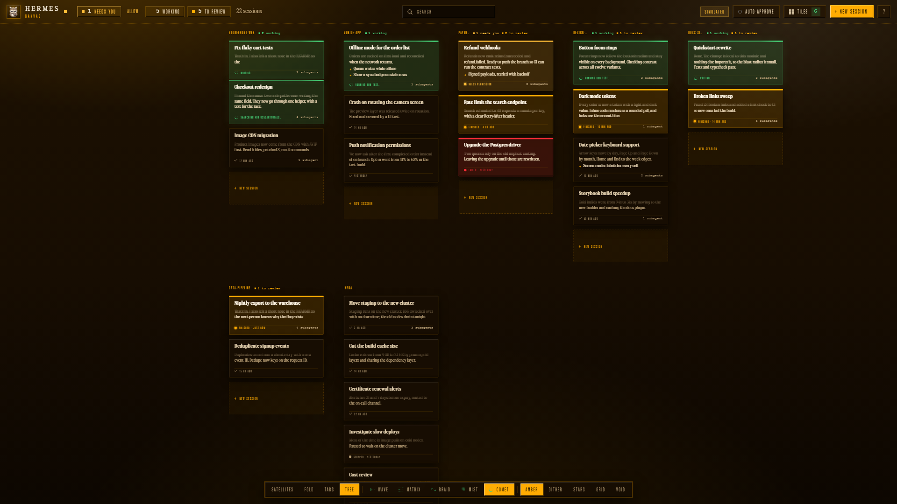
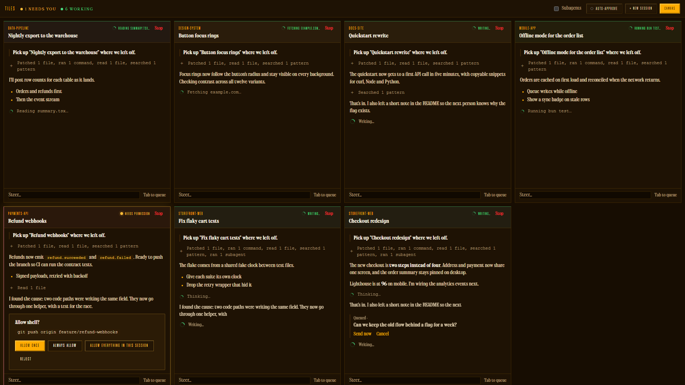
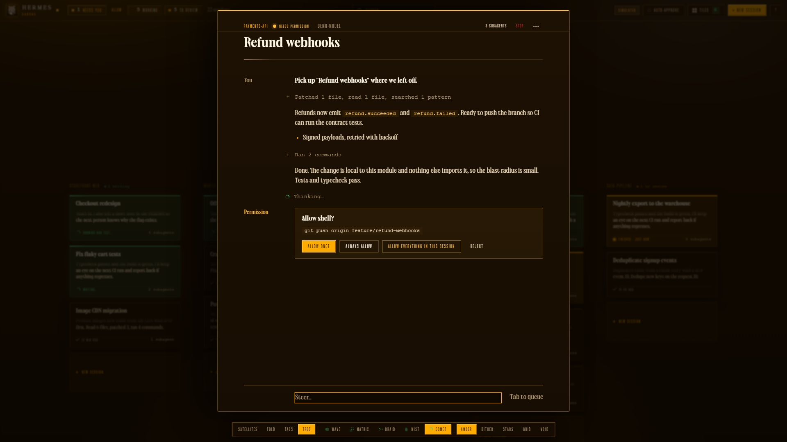

<p align="center">
  <strong>Every Hermes agent session on one infinite, zoomable canvas, with a live tiled view of running agents.</strong>
</p>

Hermes Canvas is a local web application that displays every Hermes agent session on a single infinite, zoomable canvas. It reads directly from your local Hermes session store (`state.db`), streaming live output, tool calls, and status updates across all active projects — CLI, gateway, A2A, and one-shot sessions alike. You can inspect transcripts, steer running agents, queue follow-up prompts, or monitor every running session side by side in an adaptive tiled view.

It adapts [opencode-canvas](https://github.com/DevvGwardo/opencode-canvas) to the Hermes agent store: the canvas UI (pan/zoom, layouts, tiles, transcripts, and launchpad) connects to a local Bun backend speaking Hermes (`state.db` + `hermes chat --resume … --format stream-json`) instead of the OpenCode v2 HTTP API.

## Features

### Canvas



- **Infinite pan and zoom**: Pan smoothly by dragging or scrolling; zoom with pinch or Command/Ctrl + scroll. Camera motion includes momentum and elastic boundaries (overshoot tops out at 14% of the screen).
- **Project grouping**: Sessions are arranged as cards grouped by project folder (git root, then working directory), with active work sorted to the top.
- **Dynamic layouts**: Switch between Satellites, Fold, Tabs, and Tree layouts on the fly.
- **Global search**: Press `/`, `Command+K` / `Ctrl+K`, or start typing anywhere on the canvas to search across titles, project names, loaded previews, and session history (SQLite FTS). Cards reflow with motion blur.
- **Performance**: DOM-based cards inside a single GPU-composited world layer, lazy preview loading for visible cards (4 concurrent requests), and viewport culling.
- **Session creation**: Start new sessions from the global picker (`N`) with path autocompletion and model selection, type a task in the launchpad (`L`), or use the "+ New session" card at the end of each project.

### Status at a glance
- **Edge color indicator**: A 3-pixel status line along the top card edge remains visible at all zoom levels, reinforced by border color and background tint.
- **Clear status hierarchy**:
  - **Working** (green): Agent is executing; animated light sweeps the top edge, and the footer shows the active tool.
  - **Needs you** (yellow): A permission request or question is waiting on you. Demo mode only - see below.
  - **To review** (amber): Session finished within the last 48 hours and has not yet been viewed.
  - **Failed** (red): The run ended in an error; an unseen failure keeps counting as needing review until you open it.
  - **Stopped** (neutral): Session was manually interrupted.
  - **Done** (dimmed): Completed and viewed; dims so active work stands out.
- **Read state**: Opening a session marks it viewed in the canvas sidecar (`<hermes-home>/canvas_viewed.json`); Hermes' own `last_read_at` is left untouched.
- **Attention tracking**: Top bar tallies counts for *working* and *to review* with single-click filters; browser tab title mirrors counts; press `]` and `[` to cycle through sessions requiring attention.
- **Hermes has no permission queue**, so live sessions never sit in the "needs you" state: the backend's permission/inbox/form lists always read empty. `--demo` mode fakes those prompts, which is why the screenshots show yellow *needs permission* chips and inline permission cards.

### Tiles



- **Adaptive terminal grid**: Live multi-session view displaying every running session side by side in a screen-fitted layout (`T` or `#tiles`).
- **Live streaming**: Per-tile transcripts display streaming outputs and single-line folded tool executions with color-coded project badges.
- **Integrated controls**: Each tile features an independent composer (`Enter` to steer, `Tab` to queue) — steering spawns `hermes chat --resume <id>` and streams back `stream-json` events.
- **Session lifecycle**: Finished tiles remain marked until viewed or dismissed; hover to pin idle sessions, maximize a tile, or navigate to it on the canvas.
- **Subagent visibility**: Hermes sessions with `parent_session_id` nest as child cards, like OpenCode subagents.

### Launchpad

- **One box to start work**: the task box at the bottom of the canvas launches a session straight from a prompt — no picker, no opening a card first.
- **Team mode**: by default each launch creates a lead session that uses Hermes' native `delegate_task` tool to split the task across subagents. Their child sessions appear as nested cards, exactly like any other Hermes delegation.
- **Independent launches**: every prompt is a fresh root session, so a second task starts its own team without steering, queueing into, or otherwise touching the first.
- **Destination at a glance**: the launch uses the selected card's project (or the most recent project when nothing is selected) by default. Click the project chip to choose another project, type a folder, or pick **Follow selection** to track the canvas selection again; you can also prefix the task with `@project` (for example `@hermes-canvas fix the flaky layout test`).
- **Solo mode**: turn Team off when you want one session and no subagents.
- **Model**: launches use the model remembered by the New session picker; choose a different one there and it becomes the default for the next launch.
- **Live strip**: recent launches sit above the box with their status and subagent count; click one to open its card.
- **Depth and approvals**: team launches use Hermes' `delegation` settings. `max_spawn_depth` defaults to 1 (lead → workers); raise it if workers should spawn their own workers. Commands that need approval still follow Hermes' approval settings, so turn on Auto-approve for unattended teams that use dangerous commands.
- **Demo mode**: simulated; launches work, but no real subagents are spawned.

### Sessions



- **In-place inspection**: Click any card, press `Enter`, or open `/#<session-id>` directly to inspect its full transcript in place on the map.
- **Streaming transcripts**: Renders live text streams, reasoning, and tool operations; tool-result JSON envelopes (`{"output": …}`) display just the output.
- **Steer and queue**: `Enter` sends immediately and steers a running agent mid-turn (previous turn is interrupted); `Tab` queues messages to execute after the current turn completes.
- **Model switching**: Switch models dynamically; the choice is stored on the Hermes session row and used for subsequent canvas prompts.
- **Session controls**: Stop a running agent from the header (or `Command+.` / `Ctrl+.` in the open panel, on the selected canvas card, or in a maximized tile); the `...` menu copies the resume command (`hermes chat --resume <id>`) or session ID and renames the session (via `hermes sessions rename`).

### Auto-approve
Hermes prompts for approvals inside the agent turn rather than through a server queue, so the canvas maps its switches onto the `hermes chat --yolo` flag:
- **Auto-approve (top bar)**: canvas-spawned prompts run with `--yolo` while it is on.
- **Per-session allow-everything** (`...` menu): runs that session's canvas prompts with `--yolo`. Off by default; turning it on takes a confirming second click.

## Quick start

### Prerequisites
- [Bun](https://bun.sh) ≥ 1.2
- [Hermes Agent](https://github.com/NousResearch/hermes) with sessions in your Hermes home (`%LOCALAPPDATA%\hermes\state.db` on Windows, `~/.hermes/state.db` elsewhere)

### Installation

```sh
git clone <this-repo> hermes-canvas
cd hermes-canvas
bun install
```

Link the executable to your `PATH`:

```sh
ln -s "$PWD/bin/hermes-canvas" ~/.local/bin/hermes-canvas   # or: bun link
```

### Running

Start the server and open the browser:

```sh
hermes-canvas --open
```

The interface opens at `http://localhost:4318`. It reads your Hermes `state.db` directly — no Hermes service or gateway needs to be running. Writes are limited to: inserting new session rows, updating a session's model, renaming via the Hermes CLI, spawning `hermes chat` for prompts, and the canvas' own `canvas_viewed.json` sidecar.

### Access from another PC on your network

```sh
hermes-canvas --hostname 0.0.0.0 --port 4318
```

Then from the other PC open `http://<this-PC-LAN-IP>:4318`.

> [!WARNING]
> Binding to `0.0.0.0` gives anyone on your network full control of your Hermes sessions (steer agents, run shell commands) with no extra login. Only do this on a trusted home LAN, and stop the server when done.

### Demo mode

Run simulated sessions with synthetic streaming data, without touching your Hermes store:

```sh
hermes-canvas --demo --open
```

You can also append `?demo=1` to the URL at any time.

## Usage

### Keyboard shortcuts

| Key | Action |
|---|---|
| `Scroll` or Drag | Pan the canvas |
| `Pinch` or `Command` / `Ctrl` + Scroll | Zoom the canvas |
| `+` / `-` | Zoom in / Zoom out |
| `0` or Double-click | Fit all sessions in view |
| `Left` `Up` `Right` `Down` | Move selection between cards |
| `Enter` | Open selected card or stack; in session/tile, send or steer |
| `Tab` | In session or tile, queue message for after the turn |
| `Shift` + `Enter` | Insert newline in message input |
| `Esc` | Step back one level, close panel/picker/tiles, or clear filter/search |
| `/`, `Command+K` / `Ctrl+K`, or type | Focus global search (canvas) |
| `N` | Open new session picker (preselects focused card's project) |
| `L` | Focus the launchpad task box |
| `T` | Toggle Tiles view |
| `1` – `4` | Switch layout (`1` Satellites, `2` Fold, `3` Tabs, `4` Tree) |
| `]` / `[` | Jump to next / previous session needing attention |
| `Command+.` / `Ctrl+.` | Stop running agent (open session panel, maximized tile, or selected canvas card) |
| `?` | Toggle keyboard shortcuts overlay |

### Layouts

Select layouts using keys `1`–`4` or the layout switcher in the dock:

- **Satellites** (`1`): Projects are hubs centered on their latest session, with other sessions orbiting in concentric rings. Sessions with subagents carry a small orbit.
- **Fold** (`2`): Projects collapse into compact stacks. Click a stack to fan out its sessions; press `Esc` to fold it back down.
- **Tabs** (`3`): Projects are displayed as clean blocks organized in three-column grids.
- **Tree** (`4`): Projects are arranged in vertical columns sorted by recent activity, wrapping into additional columns for large projects.

Working sessions across all layouts are marked with customizable dock spinner animations: Wave, Matrix, Braid, Mist, or Comet.

### Tiles view

Open the tiled view with `T`, the top bar button, or by navigating to `/#tiles` in your browser URL (individual sessions also support `/#<session-id>` deep links):

- Displays all running sessions side by side in an auto-fitting grid.
- Each tile displays the project name (color-coded consistently), session title, and live status.
- Transcripts stream in real time with tool calls collapsed into single-line summaries.
- Independent composer per tile: press `Enter` to steer running agents or `Tab` to queue a follow-up message.
- Sessions remain marked as "Finished" until opened or dismissed (×).
- Hover over any tile to pin it (keeps it in the grid when idle), maximize it (or double-click header; `Esc` restores), or open it on the canvas.

## Configuration

CLI arguments supported by `hermes-canvas`:

| Flag | Default | Description |
|---|---|---|
| `-p, --port <port>` | `4318` (or `PORT`) | Port to listen on (falls back to the `PORT` env var). Pass `0` to pick a random available port. |
| `--hostname <host>` | `127.0.0.1` | Network interface to bind. Binding to non-loopback addresses exposes Hermes to your network. |
| `--home <dir>` | Hermes home | Hermes home dir containing `state.db` (or set `HERMES_HOME`). |
| `--demo` | `false` | Run simulated sessions without touching Hermes. Also enabled by appending `?demo=1` to the URL. |
| `--dev` | `false` | Enable hot-reloading for UI development. |
| `--open` | `false` | Automatically open the canvas in your default browser on startup. |
| `-h, --help` | `false` | Print usage information and exit. |

Environment overrides (also honored by the test suite):

| Variable | Purpose |
|---|---|
| `PORT` | Default listening port when `-p` / `--port` is omitted (defaults to `4318`) |
| `HERMES_HOME` | Hermes home dir (`state.db`, `config.yaml`) |
| `HERMES_CANVAS_DB` | `state.db` path directly |
| `HERMES_CANVAS_VIEWED` | Viewed-markers sidecar path |
| `HERMES_BIN` | `hermes` executable (may include args, e.g. `bun fake-hermes.ts`) |
| `HERMES_PYTHON` | Preferred Python for `hermes chat` subprocesses (auto-detected otherwise) |
| `HERMES_SITE_PACKAGES` | `site-packages` dir holding `hermes_cli` (parsed from `hermes --version` otherwise) |
| `HERMES_CANVAS_PROMPT_CWD` | Override working dir for spawned prompt processes (tests) |

## How it works

```
browser ──/api/hermes/*──▶ hermes-canvas (Bun) ──SQLite──▶ <hermes-home>/state.db
        ◀──SSE────────────                    ──spawn──▶ hermes chat --resume … --format stream-json
```

- **Server** (`src/server/`): `hermes.ts` maps Hermes rows to canvas sessions/messages/projects, polls `state.db` (1s) for external changes (gateway/CLI sessions), and manages background `hermes chat` processes for steering, translating `stream-json` (`text`, `tool_use`, `tool_result`, `result`) into the canvas event vocabulary (`session.execution.*`, `session.text.*`, `session.tool.*`). `server.ts` serves the UI plus `/canvas/config`, `/api/hermes/*`, and the SSE feed. Enforces CSRF and origin security: requests with a foreign `Origin`, a cross-site `Sec-Fetch-Site`, or a non-loopback `Host` receive a 403 Forbidden response.
- **Store** (`src/app/store.ts`): Loads the most recent 600 sessions, active sessions, and project lists on boot; tracks real-time updates through the event feed. Card previews load lazily for visible cards (4 at a time).
- **Canvas** (`src/app/canvas.ts`, `camera.ts`, `layouts.ts`): Renders DOM cards inside a transformed world layer. Layouts are computed as pure functions, movements follow critically damped springs, off-screen cards are culled.
- **Transcript** (`src/app/transcript.ts`): Shared by the open-session panel (`panel.ts`) and every tile (`tiles.ts`). Applies streaming events directly to the transcript and reconciles with `GET /message` after each step.
- **Launchpad** (`src/app/launchpad.ts`): Creates a session row and prompts it through the same server path as any other canvas prompt. Team launches only add orchestration instructions to that prompt; the actual fan-out is Hermes' native `delegate_task` tool, so the canvas keeps its single source of truth (`state.db`) and needs no separate dispatcher.
- **Backend** (`src/app/hermes-backend.ts`): Implements the `Backend` interface (shared with the demo backend) against `/api/hermes/*`. Permission/inbox/form queues read empty (Hermes approvals happen inside the agent turn); allow-everything maps to `--yolo` on spawned prompts.

### HTTP & SSE endpoints (`src/server/server.ts`)

- `GET /`, `GET /canvas/config`: serves the canvas UI and active store/mode configuration
- `GET /api/hermes/event`: Server-Sent Events stream (`server.connected`, `session.*`, keepalive pings)
- `GET /api/hermes/project`, `GET /api/hermes/model`, `GET /api/hermes/model/default`: project directories, available models, and default model
- `GET /api/hermes/session/active`, `GET/POST /api/hermes/session`: running session IDs, session list/search (`?limit`, `?search`), and session creation
- `GET/PATCH /api/hermes/session/:id`, `GET /api/hermes/session/:id/message`: session details, title/yolo updates, and paginated message history
- `POST /api/hermes/session/:id/{prompt,interrupt,view,model}`: steer or queue prompts, interrupt turns, mark viewed, and switch session model
- `GET/POST/DELETE /api/hermes/session/:id/{permission,inbox,form}`: empty-list / no-op shims for Hermes compatibility
- `GET /api/hermes/fs/list`, `GET/POST /api/hermes/approve`, `GET /api/hermes/yolo`: directory browsing and `--yolo` auto-approve state

### Hermes concepts used

- `state.db`: `sessions` (id, source, model, title, cwd, git_repo_root, parent_session_id, tokens, cost, ended_at/end_reason, archived/hidden) and `messages` (role, content, tool_calls JSON, tool_call_id/tool_name, reasoning, timestamp).
- `delegate_task`: Hermes' native subagent tool. Team launches ask the lead session to use it; each child session is written with `parent_session_id`, so the canvas nests it automatically.
- `hermes sessions rename` for renames; `hermes chat --resume <id> -q … --format stream-json [-m model] [--yolo]` for prompts.
- Model list: distinct session models plus `custom_providers` models from `config.yaml`; default from `model.default`.
- `canvas_viewed.json` sidecar for read state (Hermes' own `last_read_at` is never written).

## Security

Hermes Canvas runs `hermes chat` subprocesses that can read/write files and execute shell commands as you.

- Listens on `127.0.0.1` by default. Binding to an external interface (`--hostname`) exposes your Hermes sessions to that network.
- The database is opened read-only for queries; writes go through the Hermes CLI or single-row SQL with busy timeouts, and never touch conversation content.
- Foreign `Origin`, cross-site `Sec-Fetch-Site`, and non-loopback `Host` headers are rejected to prevent malicious websites from interacting with your agents.
- Auto-approve (`--yolo`) lets agents execute commands without asking and requires deliberate activation.

For vulnerability reporting guidelines, please refer to [SECURITY.md](SECURITY.md).

## Development

```sh
bun run dev        # Run with hot reload
bun run demo       # Run with simulated sessions
bun run build      # Bundle UI assets into dist/
bun run test       # Run test suite (runs `bun test --isolate`; isolated temp Hermes home + fake hermes CLI)
bun run typecheck  # Run TypeScript type checker
```

When inspecting the canvas in your browser developer console, `hermesCanvas.store`, `hermesCanvas.canvas`, and `hermesCanvas.launchpad` are available as live objects on the global scope.

## License

This project is licensed under the [MIT License](LICENSE).

Fonts in `assets/fonts/` are self-hosted under the SIL Open Font License 1.1 (Inter, Oswald, DM Serif Display, Courier Prime) — see [assets/fonts/LICENSE](assets/fonts/LICENSE) for per-file attribution. No CDN is used at runtime.

---

Hermes Canvas is an independent project and is not affiliated with or endorsed by the Hermes or OpenCode teams. Canvas UI adapted from [opencode-canvas](https://github.com/DevvGwardo/opencode-canvas) (MIT).
